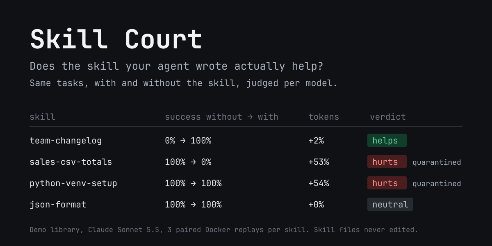

# Skill Court

A Hermes Agent plugin that tests whether the skills your agent wrote actually help. It replays real
tasks with and without each skill in Docker sandboxes, scores the difference per model, and hides
harmful skills from the models they hurt without editing their files.

- Plugin, documentation and disclosure: [`skill-court/`](skill-court/README.md)
- Demo skill library and setup: [`demo/`](demo/setup.sh)
- Tests: `uv run --no-project --with pytest python -m pytest -q`

MIT licensed.
