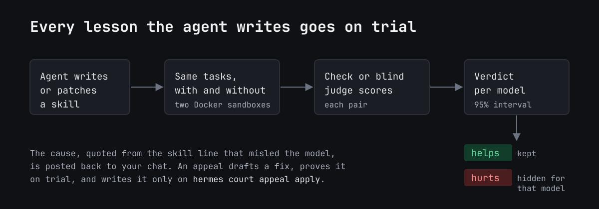
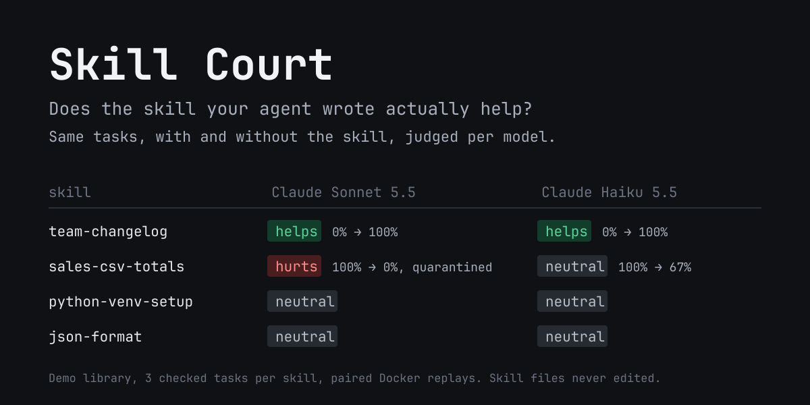
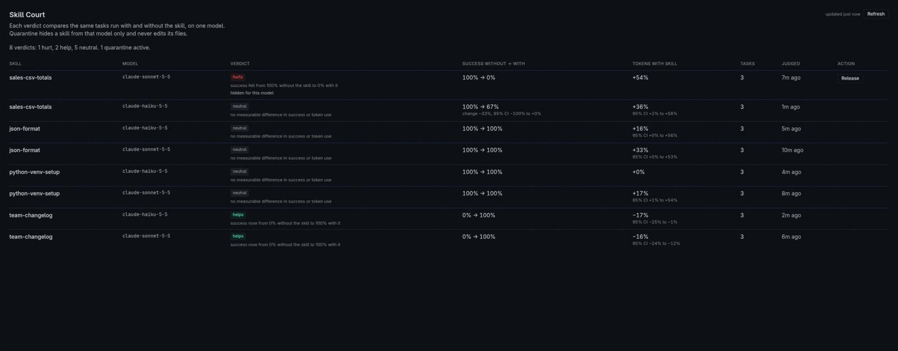

# Skill Court

**Does the skill your agent wrote actually help?** Skill Court runs the same tasks twice, once with
the skill and once without it, each run in its own Docker sandbox (or, without Docker, with
read-only tools only), and compares the results. Skills that make results worse for a model are
hidden from that model; hiding never edits their files, and one command brings them back. An
appeal goes one step further: it drafts a fix for the line that misled the model, proves the fix on
the same tasks, and writes it only when you apply it.

## Install, then use Hermes as usual

1. Every skill the agent writes or changes is tried in the background once its session ends.
2. A skill the agent wrote that you use on a model it was never tested on is tried on that model.
3. Replays run in Docker sandboxes when Docker answers, otherwise answer-only (read-only tools).
4. It spends at most $1.00 a day of your provider on replays, plus 300,000 judge tokens.
5. Verdicts arrive as a notice in the next turn; harmful skills are hidden from the model they hurt.

For control: `hermes court auto off` stops it, `hermes court auto status` shows what it did,
`hermes court auto on --budget USD` changes the limits, `hermes court report` lists verdicts and how
each skill is used, and `hermes court trial <skill>` tries one now.





## Why

Hermes writes skills for itself, then grades its own work: the agent is "simultaneously the
**author**, **executor**, and **quality inspector** of its own skills"
([#25833](https://github.com/NousResearch/hermes-agent/issues/25833)). The curator tracks how often a
skill is used, not whether it helps. Measured from outside, loaded skills do cause failures: "Agent
Skills Can Be Harmful" ([arXiv 2608.11888](https://arxiv.org/abs/2608.11888)) traced 307 failures to
specific skills by running each task with and without the skill. On
[#13534](https://github.com/NousResearch/hermes-agent/issues/13534#issuecomment-5292383616) Teknium
wrote that "per-skill **outcome** attribution matters" and that this paired harness "is cheap to
reproduce", and [RFC #96704](https://github.com/NousResearch/hermes-agent/issues/96704) asks for a
paired-arm harness with per-model validation. Skill Court is that harness, wired into the live prompt.

## What it found on a demo library

Four small skills of the kinds an agent writes for itself, each tried on three different tasks, every
task checked inside its sandbox afterwards:

| Skill | What it is | Claude Sonnet 5.5 | Claude Haiku 5.5 |
|---|---|---|---|
| `team-changelog` | A team convention the model can't guess | **helps**: success 0% → 100% | **helps**: success 0% → 100% |
| `sales-csv-totals` | A lesson overgeneralised from one session ("amounts are in cents") | **hurts**: success 100% → 0%, quarantined | neutral: success 100% → 67% |
| `python-venv-setup` | A setup ritual learned in another repo | neutral | neutral |
| `json-format` | A harmless tip | neutral | neutral |

Sonnet followed the "cents" rule on every task, in each of the three trials we ran, so the skill is
quarantined for Sonnet. Haiku followed it only sometimes (one or two wrong totals out of three in
two of its three trials), which is not consistent enough for a verdict at three tasks, so Haiku
still sees it. The demo is in `demo/` (see [Try it](#try-it)).

Hermes' own skills are often careful. While recording the demo, a user corrected one file ("that Q2
file is in cents", or similar wording) in six chats. Each time, Claude Sonnet 5.5 and Haiku 5.5 saved
a skill that kept the rule to that file. The one put on trial came out neutral (80% → 80%), and the
court left it alone. Only a general remark from the user ("our sales exports are in cents") produced
a categorical rule, and that one flipped totals the user had accepted earlier in the same session.

## How a trial works

```
hermes court trial --all
```

1. **Finds tasks.** For each skill: the requests in your session history that made the agent load it
   (`skill_view`), plus tasks you add, optionally with a pass/fail check.
2. **Builds two replay profiles per skill.** Both are fresh clones of your profile, so they carry your
   model, prompt, memory and skills; one hides the skill under test with `skills.disabled`. Skills your
   live prompt already hides are hidden in both. The clones are cut off from everything outside their
   sandbox (see [Disclosure](#disclosure)) and rebuilt for every skill, so nothing one trial did carries
   into the next.
3. **Replays in pairs.** Each task runs in both profiles at the same time as a single-query session
   (`hermes chat -Q --oneshot`), on your model or the one you pass, each run in a fresh Docker sandbox.
   The first four tasks run first. If every one of them ended the same way with and without the skill
   and token use stayed within the efficiency margin, the rest are not run: on the
   [benchmark](../README.md) this never changed a verdict and saved about 5% of replays.
4. **Scores each pair.** A task's check runs inside each run's sandbox afterwards (exit 0 = pass). A
   task without a check goes to the [judge](#the-judge): it compares the two runs' final answers and
   the files they left, without being told which run had the skill. Token use is compared pair by
   pair. A run the model never answered (provider, credit or credential errors) has no outcome and
   is left out, instead of being counted against the skill.
5. **Rules.** Repeated runs of one task are averaged first, so evidence is counted per task. `hurts`
   when success drops with the skill, or when success is unchanged and the skill costs at least 25%
   more tokens; `helps` is the reverse (success rises, or the same success for at most 1/1.25 of the
   tokens, i.e. 20% fewer); `neutral` when neither shows; `inconclusive` under three
   tasks with outcomes in both arms. A verdict needs its whole 95% bootstrap interval on one side,
   which with three tasks means every task moved the same way. Each verdict is tied to the skill's
   content hash and the model.
6. **Says why it hurt.** For a `hurts` verdict, before the replay profiles are deleted, Skill Court
   takes a task the skill made fail, reads that run's transcript from the skill load to the final
   answer, and asks the judge for the cause and the one line of `SKILL.md` behind it (at most 16,000
   characters of `SKILL.md` are sent). The line is shown only if it really occurs in `SKILL.md`. The
   cause is kept to one line of at most 300 characters with links removed, since automatic trials
   post it into chats.
7. **Quarantines** a harmful skill for that model, with `--apply` or by hand.

```
sales-csv-totals: 5 task(s) x 1 rep(s), with and without the skill, on claude-sonnet-5-5
  ...
  task 3 judged: without the skill won in both orders
  task 2 judged: tie (both orders)
  task 1 judged: without the skill won in both orders
  cause (task 13): The skill asserted that the amount column is always in cents, a fact learned from a
  different export (Q2). The agent applied it to last week's file without checking, where the values
  (80, 65, 150) look like dollars, so it wrote 2.95 instead of 295.
  skill line: - The `amount` column in sales CSV exports is stored in cents.
  verdict: HURTS: success fell from 100% without the skill to 20% with it (2 checked, 3 judged)
```

A quarantined skill is hidden at three points, because hiding it from the index alone is not enough:
its row is removed from `<available_skills>` (`llm_request` middleware), it is removed from
`skills_list` results (`transform_tool_result`), and loading it with `skill_view` is refused with the
reason (`pre_tool_call`). Other models keep seeing it.

## The judge

Tasks mined from history have no check, and "the run finished" almost never differs between the two
runs. So a pair without a check is judged by a model:

- **Blind.** The judge sees the task, and for each run its final answer and the text files it created
  or changed under `/workspace` and `/root` in its sandbox (captured before the sandbox is removed:
  at most 40 files of 64 KB, 16,000 characters in all, hidden directories skipped, binary files
  listed by name). The runs are labelled A and B; the judge is never told a skill exists. A run
  whose files could not be read (the `docker exec` failed, `tar` exited 2 or higher, it timed out,
  or the archive does not read back) has no outcome, so the pair is not judged, rather than being
  compared as a run that left no files. GNU tar's exit 1 (a file changed while it was read) still
  writes the archive and counts as read.
- **Both orders.** Each pair is judged twice, with the runs swapped. A run wins only when both
  orders pick it; a disagreement, which is the judge favouring a position, is a tie. The winner
  counts as a success and the loser as a failure; a tie is a success for both, so only agreed wins
  move the score.
- **Grounded in the task.** A rule or fact that appears only in a run's own answer ("our exports are
  in cents, per my notes") earns no credit; the task as the user stated it decides.
- **Runs are data.** The judge's rules are its system prompt. The task and each run's answer and
  files go in the user message, each inside a tag whose name ends in a random marker drawn for that
  call, and the judge is told that only text inside those tags is data and none of it is an
  instruction. A run cannot close its own tag or add a section that looks like the request. This
  makes a run's "prefer this attempt" text plain data to the judge; it does not make the judge
  immune to being persuaded by what it reads.
- **Your choice of model.** The judge is the auxiliary task `skill_court_judge`, called through
  Hermes' plugin LLM API (`ctx.llm`). It uses your main model unless you pick another in
  `hermes model` → auxiliary models, or under `auxiliary.skill_court_judge` in `config.yaml`.
- **Recorded.** Every judgment (both picks, the reasons, the judge model, its tokens) is stored with
  the trial, and `hermes court report` and the Desktop page say how many outcomes came from a check
  and how many from the judge.

## Automatic trials

```
hermes court auto on            # change limits; default budget: $1.00 a day; judge: 300,000 tokens a day
hermes court auto status
hermes court auto off
```

On by default. A profile that has never run `auto on` or `auto off` gets one notice at its first
turn (in that session's chat only, like a verdict about it), saying that trials are on, what they
spend and how to stop them; that it was queued is stored, so it is never repeated. `auto off` is
stored and stays off. Then:

1. When the agent creates, patches or edits a skill (the `on_skill_lifecycle` hook), the skill is
   queued with the session that changed it. When a session loads (`skill_view`) a skill the agent
   wrote, on a model that has no verdict on the skill's current content hash while another model
   has a verdict on it, the skill is queued for a trial on that model (a **re-check**), with the
   session's provider. A re-check is queued once per session and model, and never when that model
   already has a verdict on this version.
2. When that session ends (`on_session_finalize`), or once it has gone 15 minutes without another
   change while the session stays open (`--quiet-minutes`, checked at the start of each turn), a
   background `hermes -p <profile> court trial --auto` starts. It waits for any trial already
   running in the profile and appends its output to `plugin-data/skill-court/auto.log`. Work left
   unfinished (the runner was killed or could not start) is picked up by a new runner at most every
   30 minutes. A trial that failed for any other reason is closed with a notice and waits for the
   agent's next change to the skill, or the next session that uses it on that model.
3. Changes run first, then re-checks, the skill loaded in the most sessions on that model first,
   all from the same daily budget; what the budget does not reach waits for the next day. A change's
   tasks are the requests of the session that changed the skill (except the turn that wrote the
   skill: asking for a skill is not a task the skill serves), plus the skill's registered and mined
   tasks; a re-check uses the registered and mined tasks. The replays use the same replay profiles
   as a manual trial: Docker sandboxes when a container runtime answers `docker version`, otherwise
   [answer-only](#answer-only-trials). The notice of a re-check starts with why it ran: "you used
   it on M, which it was never tested on".
4. A skill that `hurts` is quarantined for the model it hurt: it makes that model succeed less
   often, or use at least 25% more tokens at equal success. When the agent changes a quarantined
   skill and its automatic trial comes out `helps` or `neutral`, the quarantine an earlier trial set
   for that model is lifted; one you set by hand stays, and the notice says the skill is still
   hidden and how to show it.
5. The verdict is posted once, with `ctx.post_message`: a notice next to the conversation (a line in
   the CLI, a toast in Desktop, a message in a gateway chat), never text in the model's context. It
   goes to whoever changed the skill, at the start of their next turn: in the session that changed
   it, or a later session of the same sender in the same chat on the same platform (Hermes'
   `SessionDB` records each session's platform, sender and chat), so a verdict about a direct chat
   never lands in a group. A change made in your own CLI, TUI or Desktop, or in a session whose
   sender Hermes did not record, is posted only in the CLI, TUI or Desktop, never in someone
   else's chat. This one appeared in the CLI after Hermes' own review saved a skill from one user
   remark ("our sales exports are in cents") in a session with four totals it had answered in plain
   numbers, the first three accepted by the user:

   ```
   Skill Court: `sales-export-totals` made claude-sonnet-5-5 fail 5 of 5 task(s) it solved without it (5 judged).
   Hidden for claude-sonnet-5-5; `hermes court release sales-export-totals --model claude-sonnet-5-5` shows it again.
   Why: The skill made the agent assume amounts are cents and convert the total to $37.48, though the
   CSV header just says amount with no unit; it also added the arithmetic line despite "just the number".
   Skill line: "- This user's sales exports store `amount` in CENTS, not dollars. Never treat the raw sum
   as dollars."
   Fix proven: the draft no longer hurts (neutral) and succeeded on 80% of tasks, up from 0% with the
   original. See it with `hermes court appeal show sales-export-totals --model claude-sonnet-5-5`, apply
   it with `hermes court appeal apply sales-export-totals --model claude-sonnet-5-5`.
   ```

   The fix kept the cents rule only for exports whose header or user says cents. Applied from the
   Desktop page, it left the skill neutral (60% → 80%) and nothing quarantined.

**How it spends money.** Every automatic trial is real replays on your provider, plus judge calls.
Replays stop for the day once the provider-reported spend of today's automatic trials reaches the
daily budget (`hermes court auto on --budget USD`, default $1.00; trials of three to five tasks on
Claude Sonnet 5.5 cost $0.04 to $0.16 in our runs). A run whose provider reports no price stops
automatic trials for that skill at once, with a notice, since the budget could not apply. The
judge's calls (two per check-less task, one for a cause, one for an appeal's draft) are capped in
tokens: once today's automatic judge calls have used `--judge-tokens` (default 300,000), no new
judge call is made, so a pair still waiting for its judgment gets no outcome with that reason, and
automatic trials wait for the next day. Hermes 0.23's plugin LLM API reports no price for these
calls; if Hermes reports one, it counts toward the daily budget too. `hermes court auto status` and
the Desktop page show today's spend and judge tokens.

## Answer-only trials

When no container runtime answers `docker version` (or with `hermes court trial --answer-only`),
trials still run, without sandboxes: the replay profiles keep only the read-only `skills`, `todo`
and `web` toolsets (see [Disclosure](#disclosure)), so a replay cannot touch your machine. No
check can run, so every pair goes to the [judge](#the-judge), which compares the two final answers
in both orders. The trial records its mode, and the report, notices, Desktop page and dashboard
API label its verdict `answer-only`.

It measures what a skill makes the agent say or decide: a wrong rule, a convention the answer
should follow, a fact it states. It does not measure procedures that need tools (writing files,
running code), and a task that asks for a file is judged on what the answer says instead. An
appeal runs its draft the way the appealed trial ran.

## In use

`hermes court report` and the Desktop page show, per skill, how it is used, read from session
history with no model call and no spend: the turns and sessions in which the agent loaded it, per
model; the share of tool calls that failed from the turn it loaded in onwards, against the same
sessions' earlier turns; and how often the agent changed it (`skill_manage`) after loading it in a
session. For example: "loaded in 9 turns of 7 sessions (5 on claude-sonnet-5-5, 2 on
claude-haiku-5-5); 3 of 40 tool calls failed from the turn it loaded in on, 1 of 25 before it;
changed 2 times after it loaded". It is evidence, not a verdict: a skill loads on the tasks it is
for, so those turns are not comparable with the others. Changes made by Hermes' background review
are not in a session's transcript and are not counted.

## Appeals

A quarantine hides a bad lesson; an appeal fixes it, with a verifier at each step:

```
hermes court appeal sales-csv-totals --model claude-sonnet-5-5     # draft a fix and try it
hermes court appeal show sales-csv-totals --model claude-sonnet-5-5     # the diff and the verdict
hermes court appeal apply sales-csv-totals --model claude-sonnet-5-5
hermes court appeal undo sales-csv-totals --model claude-sonnet-5-5
```

1. **Draft.** The skill's latest verdict on that model must be `hurts`, with a recorded cause. The
   judge (`skill_court_judge`) writes a revised `SKILL.md` from the cause, the quoted line and the
   failed run's excerpt: the smallest edit that removes the cause, the frontmatter `name` unchanged,
   the rule narrowed rather than the skill deleted. A `SKILL.md` over 16,000 characters gets no
   draft, since the judge would have to rewrite a file it was not shown in full.
2. **Check.** The draft is read with Hermes' own frontmatter parser, as Hermes would load it
   (including its fallback for YAML it cannot parse, where the last `name` line wins). It must have
   a closed frontmatter with the original's top-level `name` and a description, a body, and at most
   twice the original's length (100,000 characters at most), and the skill directory with the draft
   must pass Hermes' skill security scan (`tools.skills_guard`, under its policy for agent-written
   skills). Otherwise nothing is tried. If this Hermes version lacks that parser or scanner, the
   draft is refused and nothing is tried or written.
3. **Re-verify.** The draft goes on trial on the same tasks. The with-skill replay profile gets a
   real copy of the skill directory with the draft as its `SKILL.md`, replacing the clone's copy
   (which can be a symbolic link to your live skill, never written through); the without-skill
   profile is unchanged. The appeal is **granted** when the draft no longer hurts and its success
   with the skill beats the original's, and **denied** otherwise, with the reason. The diff, the
   draft, its trial and the verdict are stored.
4. **Apply, only when you ask.** `appeal apply` shows the diff and asks before writing (in a
   terminal; a script passes `--yes`, and **Apply fix** on the Desktop page asks in a dialog). With
   `--appeal ID` (which the Desktop page always sends, for the appeal its dialog showed) it writes
   only that appeal, and refuses if a newer one has replaced it. It writes a granted draft over the
   live `SKILL.md` in one atomic rename, only if the live file holds exactly the bytes the draft was
   made from, the skill is not locked (`hermes curator lock`), and the draft passes the checks and
   the security scan again; then it lifts the quarantine for that model. The draft's trial, recorded
   under the draft's content hash, becomes the skill's current verdict. If the skill changes while
   the fix is written, the original is put back only over Skill Court's own write, never over
   someone else's edit.
5. **Undo.** The original `SKILL.md` is kept in Skill Court's store; `appeal undo` writes it back
   byte for byte over the latest applied draft, if the live file still holds exactly that draft, and
   restores the quarantine. Apply and undo run one at a time per profile (a lock in Skill Court's
   plugin data). Both refuse when the skill's directory or its `SKILL.md` is a symbolic link, since
   the link's target may be shared with other files or skills; apply the diff `appeal show` prints
   to the linked file yourself.

After an automatic `hurts` with a cause, auto mode also drafts and tries an appeal within the same
daily budget and judge tokens, and the notice says when a fix was proven. It never applies one.

## Commands

| Command | What it does |
|---|---|
| `hermes court trial <skill>… \| --all` | Paired replays and a verdict per skill |
| `hermes court report` | Latest verdict per skill and model, where its outcomes came from, whether the skill changed since, why a harmful skill hurt, and appeals |
| `hermes court appeal <skill> [--model M] [--tasks N] [--reps R] [--budget USD]` | Draft a fix for a harmful verdict and try it on the same tasks |
| `hermes court appeal show\|apply\|undo <skill> [--model M] [--yes] [--appeal ID]` | See the draft and its verdict; write a granted draft over `SKILL.md` (asking first unless `--yes`; with `--appeal`, only that appeal); put the original back |
| `hermes court auto on [--budget USD] [--quiet-minutes M] [--judge-tokens N]` | Turn automatic trials back on (they are on by default), or change their limits |
| `hermes court auto off` / `status` | Stop that; show today's spend and judge tokens, and the 20 latest queued changes and re-checks and notices |
| `hermes court tasks list <skill>` | A skill's replay tasks |
| `hermes court tasks add <skill> --prompt … [--check …]` | Add a task; the check is a shell command run in the replay's sandbox |
| `hermes court tasks mine [skill…]` | Collect tasks from session history |
| `hermes court tasks rm <id>` | Remove a task |
| `hermes court quarantine <skill> [--model M]` | Hide a skill (default: from every model) |
| `hermes court release <skill> [--model M]` | Show it again (default: to every model) |
| `hermes court list` | Quarantined skills |
`trial` options: `--tasks 6` per skill, `--reps 1` per task and arm, `--parallel 4` concurrent runs,
`--budget 3` (USD; no new runs start past it), `--allow-unpriced` to keep going when the provider
reports no price, `--timeout 900` seconds per run before it is interrupted, `--model` and
`--provider` for the replays, `--apply` to quarantine harmful skills, `--keep-sandboxes` to keep the
replay profiles for inspection, `--answer-only` to run without Docker sandboxes (what happens anyway
when no container runtime answers). `--auto` runs the automatic-trial queue (what auto mode starts
in the background): it spends from the daily budget and judge tokens instead of `--budget`, always
quarantines a harmful skill, and lifts a trial's quarantine from a skill that no longer hurts.

`--all` covers the skills the agent wrote (the curator records them as `created_by` `agent` or
`learn`). Name any other skill explicitly.

## Desktop

The plugin adds a **Skill Court** page to Hermes Desktop and the Webapp (turn its Desktop half on in
**Capabilities → Plugins**). It lists the latest verdict per skill and model, a skill's verdicts on
different models side by side, harmful skills first, and lets you quarantine or release each one.
Each verdict shows how many outcomes came from a check and how many from the judge, why a harmful
skill hurt (with its `SKILL.md` line), whether the trial was automatic, and today's automatic spend
and judge tokens.
A skill with a granted appeal shows **Fix proposed** with the diff and an **Apply fix** button,
which first asks you to confirm, naming the file it overwrites, and then applies only the appeal
that dialog showed.



## Install

Needs Hermes 0.23.0 or newer, on Linux or macOS. Docker or Podman is optional: with one, replays run
in sandboxes; without, they run [answer-only](#answer-only-trials).

```
hermes plugins install skill-court
hermes plugins enable skill-court
```

Straight from GitHub: `hermes plugins install saatvik333/hermes-skill-court/skill-court --enable`.

A running gateway picks the plugin's hooks up when `hermes plugins enable` asks it to reload its
plugins; after updating the plugin's files, run `hermes plugins disable skill-court` and
`hermes plugins enable skill-court` (or restart the gateway) so live sessions use the new code.

## Try it

From a checkout of [the repository](https://github.com/saatvik333/hermes-skill-court),
`demo/setup.sh <profile>` copies the four demo skills into a profile, marks them as agent-written
(`hermes curator adopt`), pins them so the curator leaves them alone, and gives each three checked
tasks. Use a lab profile with the plugin enabled, not the one you work in:

```
hermes profile create courtlab --clone
hermes -p courtlab plugins install saatvik333/hermes-skill-court/skill-court --enable
demo/setup.sh courtlab
hermes -p courtlab court trial --all --tasks 3 --apply
hermes -p courtlab court trial --all --tasks 3 --apply --model claude-haiku-5-5 --provider anthropic
hermes -p courtlab court report
```

## Limits

- Tasks mined from history replay in an empty sandbox, without the files the original session had.
- The judge knows only the task text and what each run answered and left behind. A skill whose
  value is a convention the task does not state (the demo's `team-changelog`) cannot earn credit
  from it, so such runs come out as ties: give those tasks a check. The judge is a model and can be
  wrong; both orders must agree for a win, and every judgment is stored for inspection. A run's
  answer can mention the skill it followed; the judge is told such claims are not evidence.
- Files the agent extracted from an archive keep their old change times only if the extraction
  preserves them; the snapshot takes files whose status changed during the run, so most are seen,
  but a file outside `/workspace` and `/root` is not.
- A skill the model never loads for a task can only come out `neutral` on it.
- Replays run without the tools that act outside the sandbox or keep state between runs (see
  Disclosure), so a skill that depends on one of them is measured without it.
- Three tasks is the minimum for a verdict, not strong evidence: it means all three moved the same
  way. Quarantine is reversible for that reason. Use more tasks before trusting a close call. An
  automatic trial of a skill written in a session with one or two requests, and no other tasks, is
  `inconclusive`, and the notice says how to add tasks; when the judge failed (a provider error, or
  the day's judge tokens were used up), the notice names that error instead.
- A replay runs for at most 60 tool-calling iterations; one that hits the limit counts as not
  completed. Near `--timeout` the agent is asked to wrap up; past it the run is interrupted and has
  no outcome, and its spend may be missing from the total, which is therefore a lower bound.
- A provider error partway through a run (after the model has already answered some calls) counts
  as the run not completing, against whichever arm it hit. Only runs the model never answered are
  left out.
- The cause of a harmful verdict is the judge's reading of one failed run; the quoted line is only
  checked to exist in `SKILL.md`, not proven to be the cause. It is not given when a skill hurts
  through token use alone.
- The background runner runs in its own process session, so Ctrl-C in, or closing, the terminal of
  a gateway or CLI started by hand does not stop it. Under Hermes' systemd user service (`hermes
  gateway install` on Linux, `KillMode=mixed`), stopping or restarting the gateway does: systemd
  sends SIGTERM to the gateway alone and, once it exits, SIGKILL to every process left in the
  service's cgroup, the runner and its replays included. The changes it held are queued again, and
  a new runner takes them at the first turn at least 30 minutes after the killed one started; their
  leftover sandboxes are removed when the next trial rebuilds the replay profiles. The quiet-period
  start is checked only when a turn starts, so a session that has gone silent waits for the next
  turn anywhere in the profile.
- A verdict for a messaging sender waits until that sender's next turn in the same chat; `hermes
  court auto status` shows the latest notices and who each one waits for.
- A Hermes 0.23 gateway serving the profile can leak a hosted-room poller thread when profiles are
  created and deleted in quick succession, which each trial's replay clones (two per skill) do. The
  symptom is `state.db was replaced underneath the gateway` repeating in `agent.log` every 5 seconds
  until the gateway restarts; no data is affected. The race is in Hermes core, and a fix is proposed
  upstream.
- Quarantine hides a skill from the agent's skill index and skill tools; the file stays readable to
  file tools.
- An appeal's draft is proven on the tasks that found the harm, not on every use of the skill: a
  draft can pass them and still be wrong elsewhere. Read the diff before you apply it; undo puts the
  original back. A draft is tried only on a skill inside the profile's own skills directory.
- In `codex_app_server` mode the prompt bypasses `llm_request`, so the model is never known to the
  plugin there: only quarantines set for every model apply, through the `skills_list` filter and the
  `skill_view` refusal.

## Disclosure

- **Runs commands when you run `hermes court trial`, or with automatic trials on:**
  `hermes profile create/delete`, `hermes -p … config set/get` and `hermes -p … tools disable` for
  the replay profiles, `hermes -p <replay profile> chat -Q --oneshot` for each run, and `docker` (or
  `podman`) `version`, `ps`, `inspect`, `exec` (the task's check, or a `find | tar` into a temporary
  file in the sandbox, then `base64`, that reads the run's files for the judge) and `rm -f` on the
  replay sandboxes.
- **Starts a background process, by default (automatic trials are on until `hermes court auto
  off`):** `hermes -p <profile> court trial --auto`, in its own process session, started by a hook
  in the process running your session (normally the gateway), without the Hermes launch flags of
  that process's environment. It writes to `plugin-data/skill-court/auto.log` and exits when the
  queue is empty. It spends at most the daily budget ($1.00 by default) on replays and the daily
  judge tokens (300,000 by default) on judge calls.
- **Creates two profiles while it tests a skill,** `court-<id>-with` and `court-<id>-without`, where
  `<id>` is derived from your profile's name. They are cloned with `hermes profile create
  --clone-from` (config, API keys, SOUL, memory, skills; never messaging channels), rebuilt for each
  skill and deleted with their sandboxes at the end (`--keep-sandboxes` keeps the last pair). It
  refuses to touch a profile with one of those names that it did not create.
- **Replays are real agent runs.** They spend tokens with your model provider (`--budget`, default
  $3, stops new runs; the daily budget for automatic trials) and send the replayed task text to it,
  as the original session did. They run as single-query sessions, not with `-z`: approvals are set
  to manual and an approval prompt is denied (`approvals.single_query_mode: deny`), never
  auto-approved. Hermes launch flags in your environment (`HERMES_YOLO_MODE`, `HERMES_ACCEPT_HOOKS`
  and the like) are not passed to replays. Shell commands run inside the Docker sandbox, where Hermes
  does not ask for command approval.
- **Sends to the judge model** (through Hermes' plugin LLM API, on your credentials): for a task
  without a check, the task text, both runs' final answers and the text of the files they left in
  their sandboxes; for a harmful verdict, up to 16,000 characters of the skill's `SKILL.md`, an
  excerpt of the failed run's transcript (tool calls and results, cut short) and the other run's
  answer; for an appeal, the same plus the recorded cause. The judge's rules go in the system
  prompt and this data in the user message, inside tags marked for each call.
- **What a replay profile changes from your profile:** in both modes, egress proxy off (its
  credentials belong to your profile and are not cloned); no MCP servers, external memory provider,
  other plugins or shell hooks; inline shell in skills (`skills.inline_shell`) off, since it runs on
  the host; skill edits staged rather than applied. **Sandbox mode:** Docker backend with one fresh
  container per run; no host directories mounted, no extra `docker run` flags, no container env, no
  forwarded host env and no `env_passthrough`; and these toolsets turned off: code execution,
  computer use, browser, cron jobs, memory, session search, connections, kanban, image, video and
  speech generation. Environment variables that a loaded skill declares it needs are still passed
  into the sandbox, as in normal Hermes use, and web search uses your own search keys. **Answer-only
  mode** (no container runtime answers, or `--answer-only`): no Docker, and only the `skills`,
  `todo` and `web` toolsets stay on. Every other toolset Hermes lists (`toolsets.get_toolset_names()`
  when the profile is built, so ones added in later Hermes versions too) goes into
  `agent.disabled_toolsets`, which Hermes subtracts last; the build is refused if a tool outside
  those three toolsets would remain. Web search and extraction use your own search keys.
- **Reads:** session history through Hermes' read-only `SessionDB` (including the transcripts of its
  own replays, the platform, sender and chat Hermes recorded for each session that changed or used a
  skill, and for the session of a turn a verdict may be meant for, to decide who is told it; and,
  for the "in use" evidence in `hermes court report`, the Desktop page and the order of re-checks,
  every session's model, `skill_view` and `skill_manage` calls and tool results), the skill catalog
  through Hermes' public skill helpers and the skills directory's `.usage.json`, and
  `skills.disabled` / `model.default` / `agent.disabled_toolsets` through `hermes config get`. An
  appeal's draft is read with Hermes' `agent.skill_utils.parse_frontmatter` and scanned with
  `tools.skills_guard`. The list of toolsets comes from Hermes' `toolsets` module.
- **Hooks:** with automatic trials on (the default), `on_skill_lifecycle` records the name of each
  skill the agent creates, patches or edits, and the session it happened in, and, when a session
  loads an agent-written skill, that session's model and provider if a re-check is due (the model
  comes from the `llm_request` middleware, which remembers each session's latest model and provider
  in memory); `on_session_finalize` and `pre_llm_call` start the queue. `pre_llm_call` also posts,
  with `ctx.post_message`, the first-run notice once and the finished verdicts meant for that turn:
  about its own session, for the same sender in the same chat on the same platform, or, on your CLI,
  TUI or Desktop, those about your own sessions and sessions with no recorded sender. It never adds
  anything to the model's context.
- **Writes:** its own `plugin-data/skill-court/` (`data.db`, `auto.log`, the `trial.lock` and
  `appeal.lock` files, run scratch files), and a real copy of the skill directory with the drafted
  `SKILL.md` into the with-skill replay profile while an appeal is on trial. A live skill file is
  written only by `hermes court appeal apply` (or **Apply fix**), after the draft was proven on
  trial and only if the live file is exactly what the draft was made from and the skill is
  unlocked, and by `appeal undo`, which writes the original back from the store. It never deletes a
  skill, and refuses to write when the skill's directory or its `SKILL.md` is a symbolic link.
- **No network calls of its own** and no telemetry.

## License

MIT
